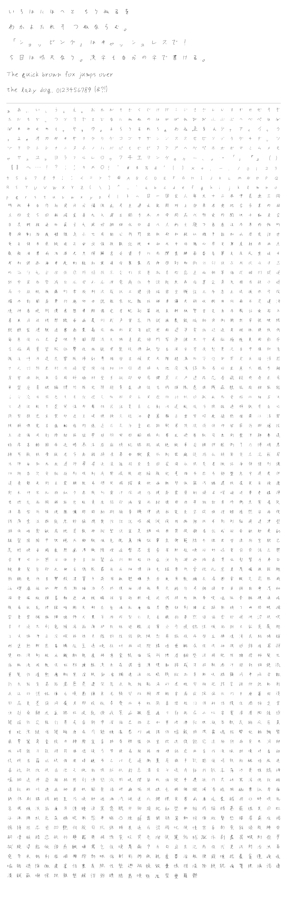

# 悪筆ST

紹介文

## 収録文字

| 区分 | 収録数 |
|---|---|
| ひらがな | 84 / 84 |
| カタカナ | 87 / 87 |
| 英数字・記号（ASCII） | 94 / 94 |
| 和文約物 | 20 / 20 |
| 常用漢字 | 2136 / 2136 |

収録されていない字は、OS やアプリが別のフォントで代替表示します。横書き専用です（縦書き用の字形は入っていません）。

## ダウンロードとインストール

[Releases](https://github.com/Majizou/akuhitsuST/releases/latest) から `ST-v1.000.zip` をダウンロードして解凍し、
`fonts/ST-Regular.ttf` をダブルクリック →「インストール」。

## ライセンス

このフォントは [SIL Open Font License 1.1](OFL.txt) で公開しています。

- 個人・商用を問わず、文書・画像・動画・Web サイト・アプリなどに自由に使えます。使って作ったものにライセンスは及びません。
- フォントファイルの改変・再配布もできます。ただし改変版も OFL で公開すること、フォント単体での販売はしないことが条件です。

Copyright 2026 悪筆ST
